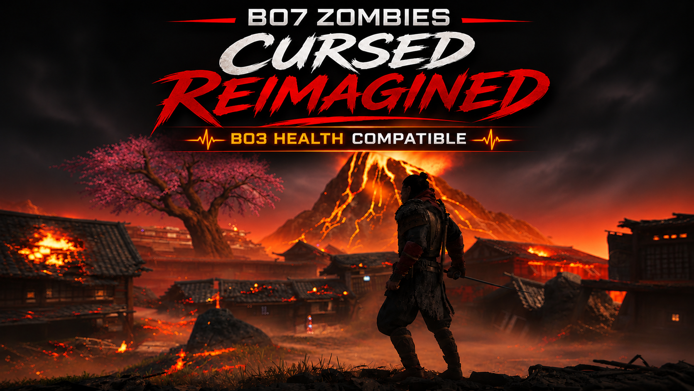

# BO7 Zombies | Cursed Reimagined – BO3 Health Compatible

A compatibility edition of Cursed Reimagined v3.28 designed to run alongside the standalone BO3 Health mod on Kronos.

## Requirements

**BO3 Health is required and must be installed separately.**

This release contains only my modified `zm_cursed_reimagined.gsc`. The standalone `bo3_health.gsc` is not included because it belongs to another mod creator.

## Compatibility Changes

This edition removes or adjusts conflicting features:

- Custom armor wall-buys removed.
- Early-round zombie damage override removed.
- Conflicting no-armor setting override removed.
- Armor restoration after loading removed.
- Starting armor cleared and armor HUD hidden.

All other supported Cursed Reimagined gameplay features remain in the compatible script, subject to components such as the separate Arsenal Lua interface.

## Credits

- **MeowRaK** — Cursed Reimagined development and BO3 Health compatibility adjustments.
- **BO3 Health** — Original standalone mod by its respective creator, distributed separately and not included in this release.
